我用 TIA Portal 和 PLCSIM Advanced 搭建了一根虚拟定位轴。从正反点动开始，完成了设置坐标基准、绝对定位、相对定位，以及运动途中的主动停止。

## 先看成果：走得动，也停得下

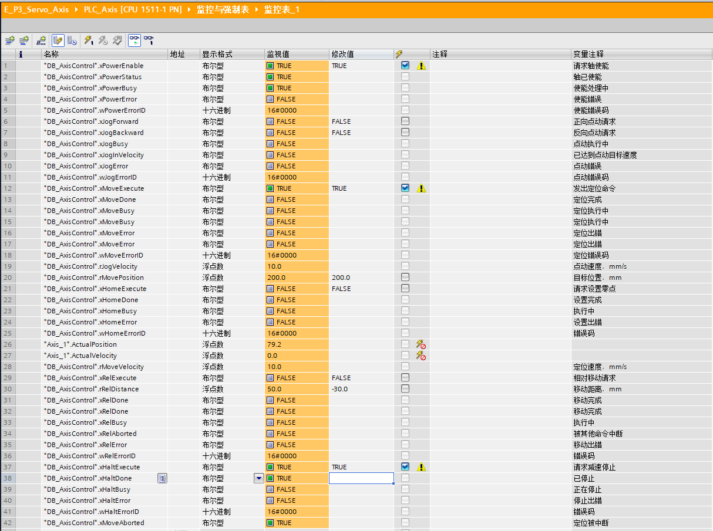

*目标200 mm，途中停在79.2 mm，停止完成且轴保持使能*

我先发出“走到 **200 mm**”的定位请求，再在运动途中触发停止。轴停在 **79.2 mm**，实际速度归零，`xHaltDone` 为 TRUE，`xMoveAborted` 为 TRUE，轴仍保持使能。

|我做的操作|实际结果|
|---|---|
|正、反向点动|速度分别约 +10 / −10 mm/s，取消请求后停止|
|定义位置基准|当前位置设为 0 mm，Home 完成|
|绝对定位|0 → 100 → 20 mm|
|相对定位|20 + 50 = 70 mm；70 − 30 = 40 mm|
|途中停止|目标 200 mm，停在 79.2 mm|
|重新运动后再停|重新发出定位请求，再停在 186.8 mm|

## 我的虚拟轴与程序结构

工程为 **E_P3_Servo_Axis**，CPU 为 **1511-1 PN**，虚拟 PLC 地址 **192.168.60.10**。我使用 `TO_PositioningAxis`，轴名 `Axis_1`，勾选“虚拟轴”，位置单位 mm、速度单位 mm/s。

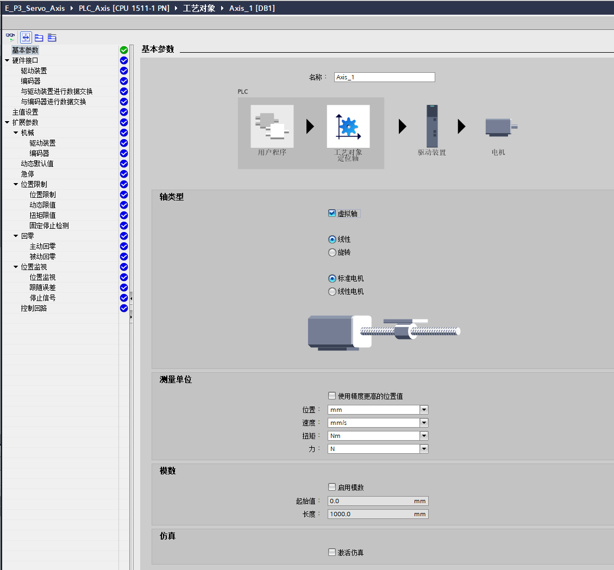

*Axis_1采用虚拟轴，线性坐标与mm单位*

> 我的操作顺序：轴使能 → 点动验证 → 建立位置基准 → 定位运动 → 途中停止。

Main（OB1）中有六段调用，`DB_AxisControl` 保存请求、参数与反馈；每条运动指令另有自己的实例 DB。

|Main 中的调用|我用它做什么|实例 DB|
|---|---|---|
|MC_Power|允许轴运动|DB_AxisPower|
|MC_MoveJog|正反点动|DB_AxisJog|
|MC_MoveAbsolute|走到指定坐标|DB_AxisMove|
|MC_Home|定义当前位置坐标|DB_AxisHome|
|MC_MoveRelative|再走一段指定距离|DB_AxisRelative|
|MC_Halt|减速停止当前运动|DB_AxisHalt|

展开：使能与点动的接线

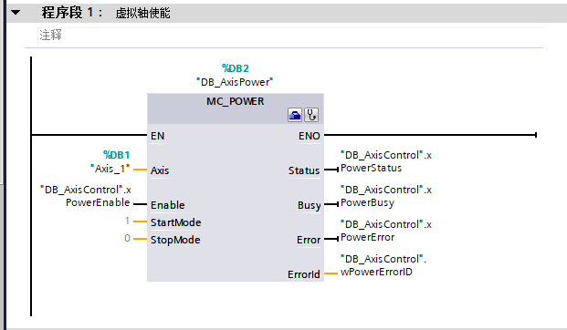

*MC_Power连接使能请求与状态反馈*

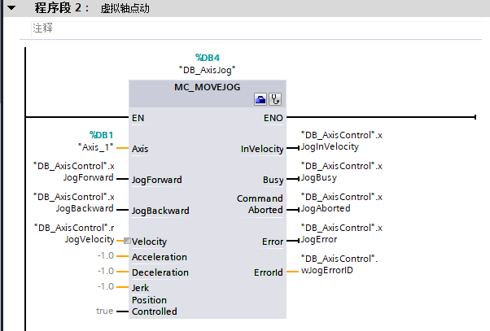

*MC_MoveJog连接正反点动与速度变量*

## 点动：正向走，反向走，取消请求就停

我把点动速度设成 **10 mm/s**，分别触发 `xJogForward` 和 `xJogBackward`。正向时位置增加，反向时位置减小；取消点动请求后，实际速度回到 0。

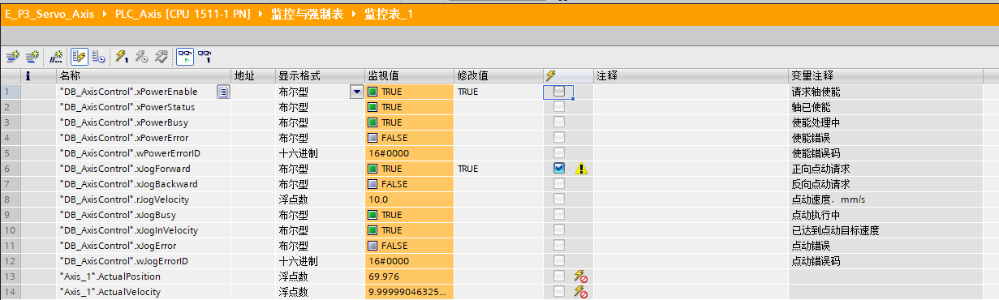

*正向点动：实际速度约+10 mm/s*

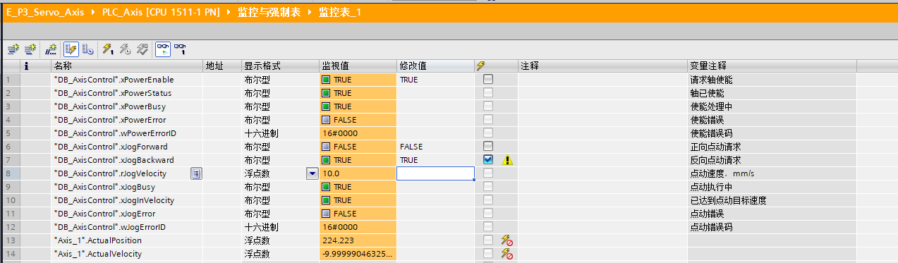

*反向点动：实际速度约-10 mm/s*

监控值中的 9.999… 接近 10，是浮点数显示现象。这次我没有同时给两个方向请求。

## 第一次定位失败：有位置数值，还不算已归位

第一次触发绝对定位时，位置没有变化，指令返回 **16#8001**。继续查看轴报警，我找到了 **MC Alarm 321：轴未归位**。

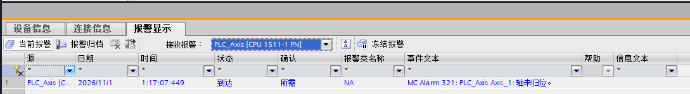

*报警321：轴未归位，绝对定位请求被拒绝*

我增加 `MC_Home`，使用 **Mode = 0、Position = 0.0**，把虚拟轴当前位置定义为零点。设置后，`xHomeDone` 为 TRUE，位置为 0，错误码为 0000。

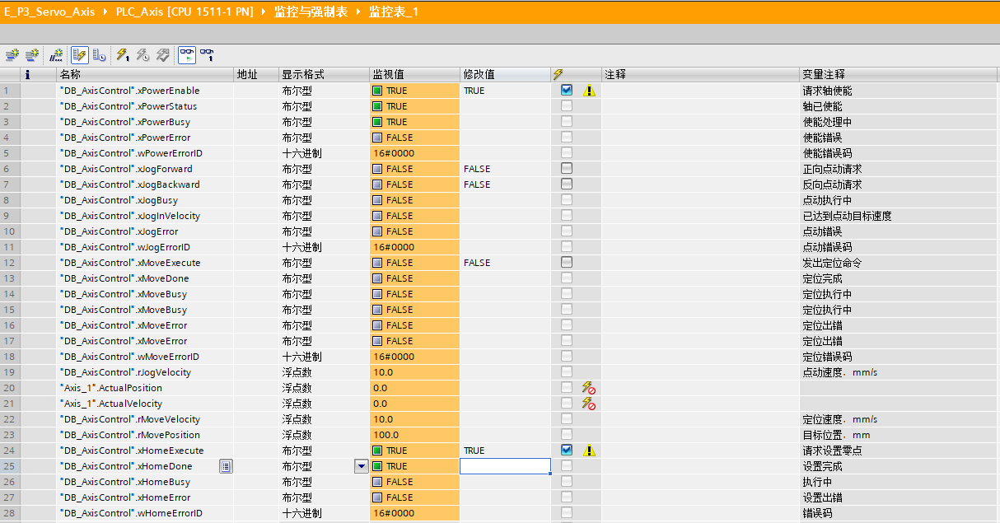

*零点设置完成，实际位置0且无错误*

**这里是在设置坐标，轴本身不移动。** 我的实验没有真实机械，可以人为选择这个基准；真实设备不能在任意位置直接清零，需要先找到可信的机械基准。

展开：设置位置基准的接线

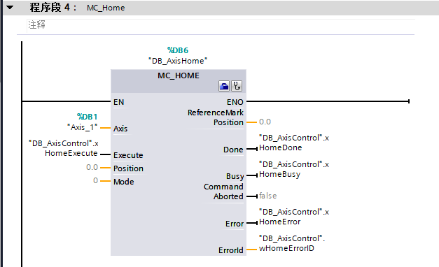

*MC_Home以Mode 0把当前位置定义为0 mm*

## 绝对定位：目标写多少，就停在哪个坐标

我先定位到 **100 mm**，完成后再把目标改为 **20 mm**，重新触发请求。轴自动反向运行，最终停在 20 mm。两次完成时，速度均为 0、Done 为 TRUE，定位无错误。

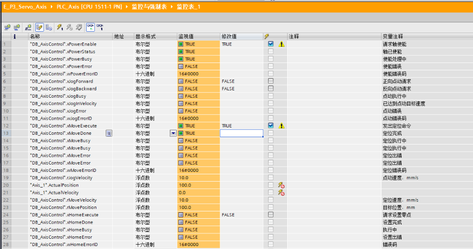

*绝对定位到100 mm完成，速度0*

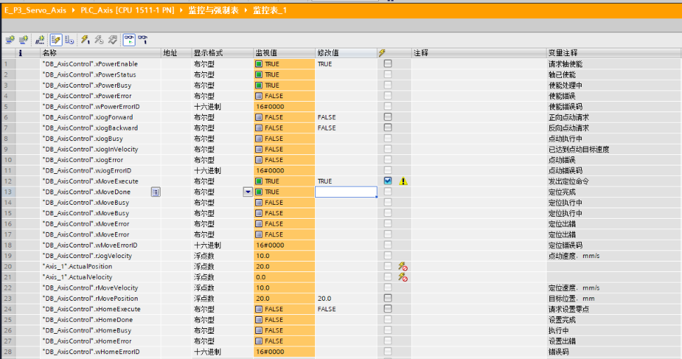

*从100 mm返回20 mm，定位完成*

展开：绝对定位的接线

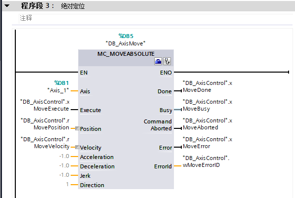

*MC_MoveAbsolute绝对定位指令*

## 相对定位：从当前坐标再走一段

绝对定位关心“去哪里”，相对定位关心“再走多远”。我用两次运动对比了正、负距离。

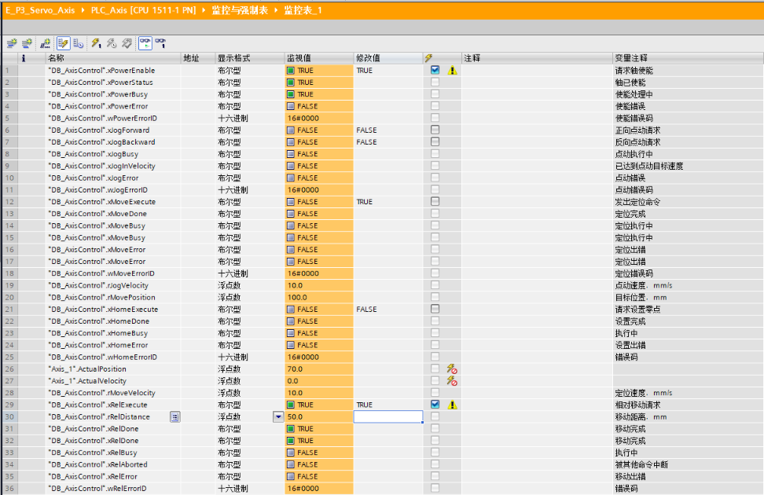

*从20 mm相对移动+50 mm，停在70 mm*

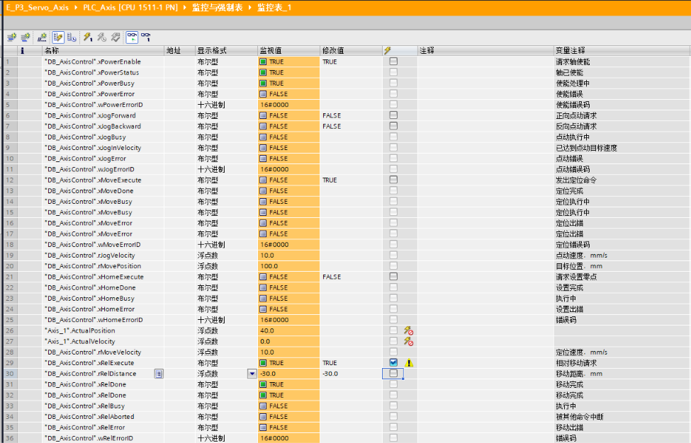

*从70 mm相对移动-30 mm，停在40 mm*

|起点|Distance（移动距离）|终点|
|---|---|---|
|20 mm|+50 mm|70 mm|
|70 mm|−30 mm|40 mm|

两次均为 Done = TRUE、Error = FALSE，错误码 0000。请求写回 FALSE 后，完成信号清除，实际位置保持。

展开：相对定位的接线

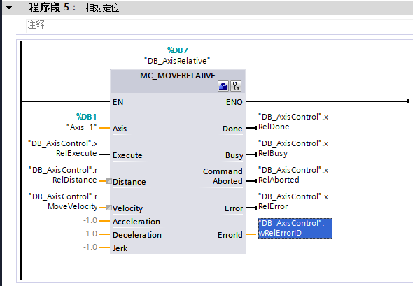

*MC_MoveRelative相对定位指令*

## 途中主动停止，再重新发起运动

我用 `MC_Halt` 中断正在执行的绝对定位。停在 79.2 mm 时，原定位的 `CommandAborted` 为 TRUE：这是被新停止命令中断，不是定位出错。

展开：减速停止的接线

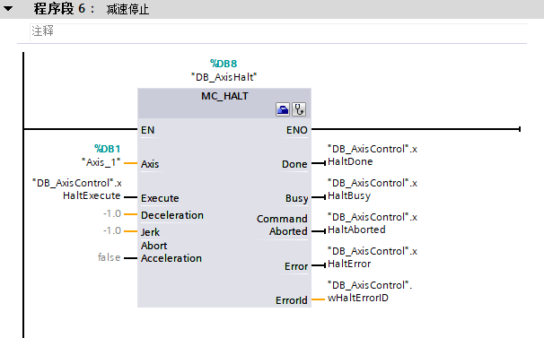

*MC_Halt减速停止指令*

我将请求复位，再重新发出绝对定位命令，轴可以继续向目标运动；再次触发停止后，停在 **186.8 mm**，速度为 0，Halt 完成且没有错误。

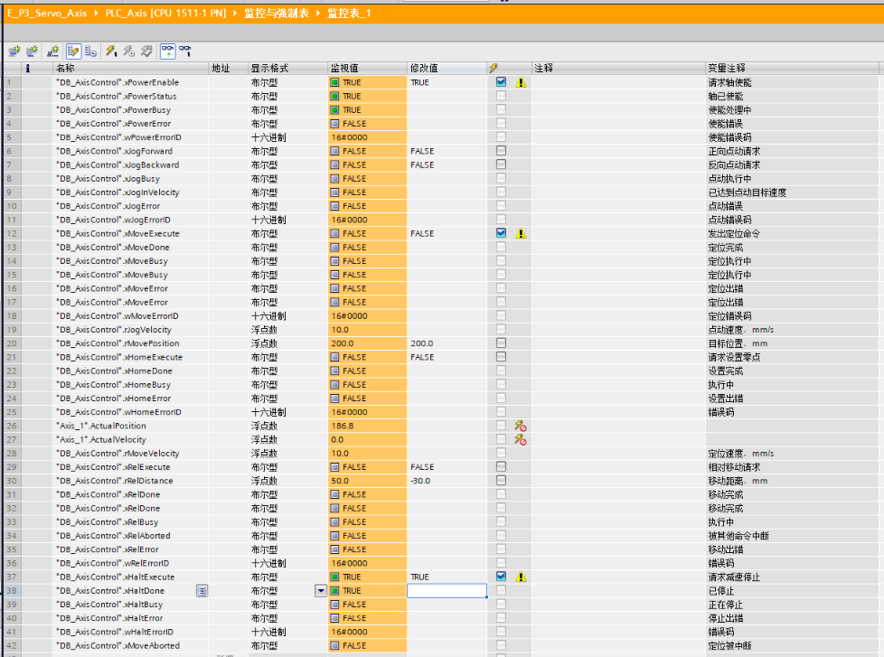

*重新发起向200 mm定位后再次停止，停在186.8 mm*

这次验证的是程序控制减速停止，**不是安全急停**。停止后的运动需要重新发出请求。

## 这次真正记住的几件事

- **Enable（使能）**：允许轴运动；`MC_Power.Busy` 持续为 TRUE，不代表故障。
- **Execute（执行请求）**：我先写 FALSE，再写 TRUE，发起新任务。只在“修改值”栏填数，还要执行修改并确认“监视值”。
- **Busy / Done**：执行中 / 已完成。Done 随请求复位而清除，不表示轴丢失了已经建立的位置基准。
- **CommandAborted**：当前任务被其他命令中断；需要结合 Error 判断，不能把它直接当错误。
- **Error / ErrorID**：是否出错 / 错误码。8001 还要继续看工艺对象的具体报警。

下载后有一次绝对定位再次被拒绝，我重新完成位置基准设置后，才继续停止实验。以后我会检查“已归位”状态，不只看位置是否显示为 0。

另一个排障是模拟 CPU 曾出现 **OB91 事件缓冲区溢出**。我将 MC_Servo 周期从 **4 ms 调整到 20 ms** 后继续低速虚拟轴测试，短时观察和后续操作未再次出现该问题。这只是本次仿真调整记录，还不能算长期稳定性验证，也不作为真实驱动的周期配置结论。

这篇记录的是我已经完成的**虚拟轴软件实验**；真实伺服、机械回原点、限位保护和自动运行流程还没有在本项目中验证。
