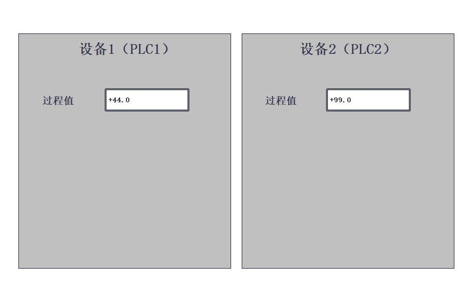
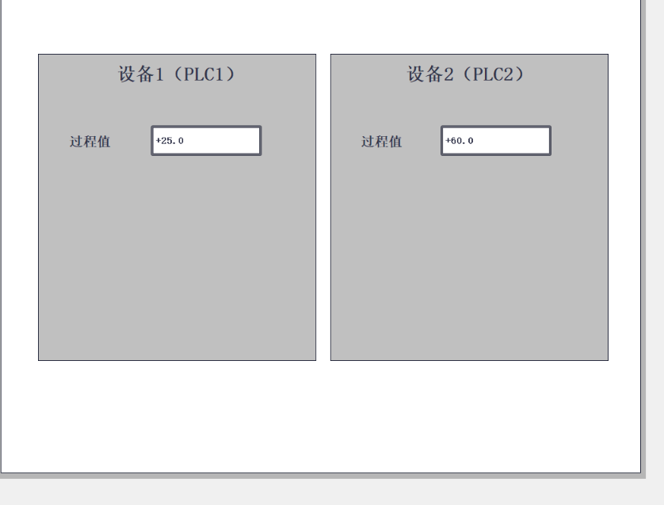
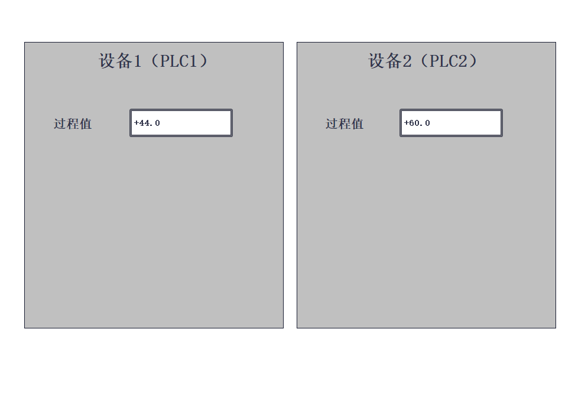
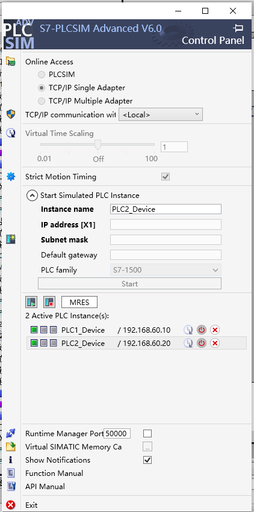
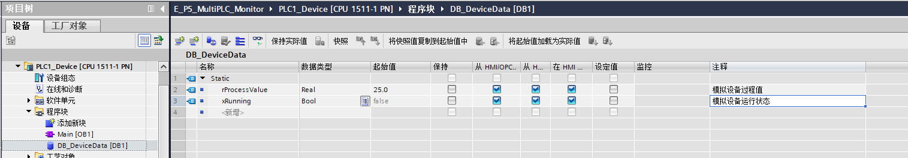
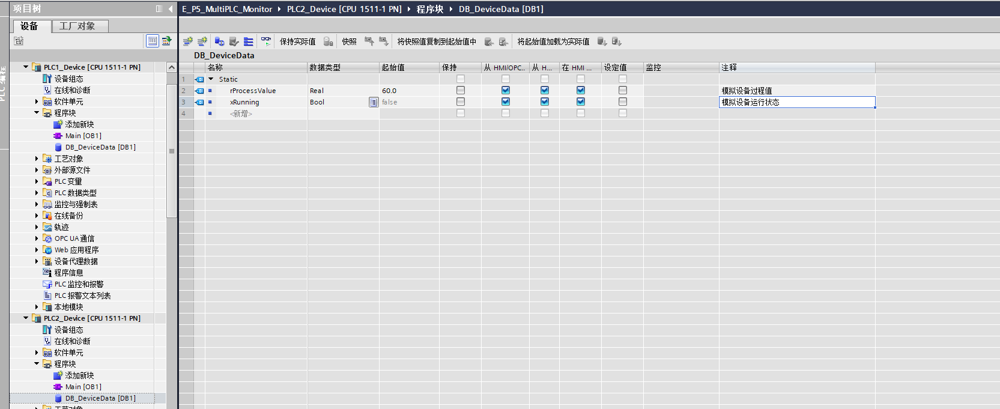
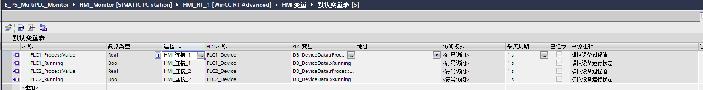
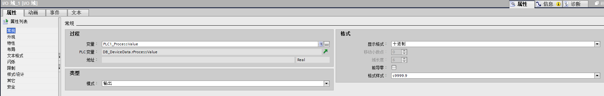

我新建了双 PLC 监控工程，用一个 WinCC Runtime Advanced 画面同时读取两台 S7-1500 虚拟 PLC 的过程值，并通过分别修改两端实际值，确认两路数据独立更新。

## 先看成果：一个画面，两台设备

左侧是 PLC1 的 **44.0**，右侧是 PLC2 的 **99.0**。两个显示框分别绑定各自的 HMI 变量。

## 从初始值到独立更新

两台 PLC 下载并进入 RUN 后，画面先读到 **25.0 / 60.0**。

我先在线修改 PLC1 的过程值为 **44.0**，左侧随之更新，右侧仍为 **60.0**；再将 PLC2 修改为 **99.0**，左侧保持 **44.0**。这次分别修改的是实际值，不是重新填写起始值。

## 我的连接与数据配置

|对象|本次配置|
|---|---|
|工程|E_P5_MultiPLC_Monitor|
|PLC1_Device|CPU 1511-1 PN，192.168.60.10|
|PLC2_Device|CPU 1511-1 PN，192.168.60.20|
|PC监控站|HMI_Monitor / HMI_RT_1，WinCC RT Advanced|
|电脑通信网卡|Siemens PLCSIM Virtual Ethernet Adapter，192.168.60.100|
|网络|PN/IE_1，子网掩码255.255.255.0|
|HMI驱动|SIMATIC S7 1500|
|读取变量|两台PLC各自的 DB_DeviceData.rProcessValue，Real|
|显示方式|输出模式，十进制，一位小数|

两台 PLC 可以使用同名 DB 和变量；HMI 通过连接区分数据来源。我用 **PLC1_ProcessValue** 和 **PLC2_ProcessValue** 分别命名画面变量。

数值框设为输出，只显示 PLC 的实际值。

## 组态时处理的两件小事

选择符号变量时，工程自动生成了关联 PLC 的 HMI 连接。我保留这些已关联的连接、删除重复手建项，再统一命名为 **HMI_PLC1 / HMI_PLC2**。

第一次编译提示“未组态起始画面”，我创建 **Screen_Main** 并设为起始画面后，HMI 编译通过，错误和警告均为 0。

这次留下的成果是：**一个 WinCC 画面同时监视两台虚拟 PLC，并能正确显示各自独立变化的过程值。**
