我在 TIA 中用 LAD 编写三档频率控制，通过 PLCSIM Advanced 和监控表完成启动、换档、降频停止与运行许可测试。最后补上防误重启逻辑：**启动请求一直保持时，即使许可恢复，也不能自动重新运行。**

## 先看成果：许可恢复，也要重新发启动

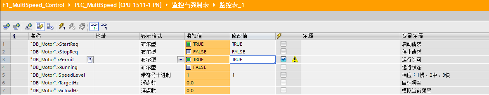

*许可恢复、启动仍为TRUE，运行保持FALSE，频率保持0*

上图中启动请求和运行许可都是 TRUE，但运行保持 FALSE，目标与模拟频率均为 0。旧启动请求没有让系统自动恢复运行。

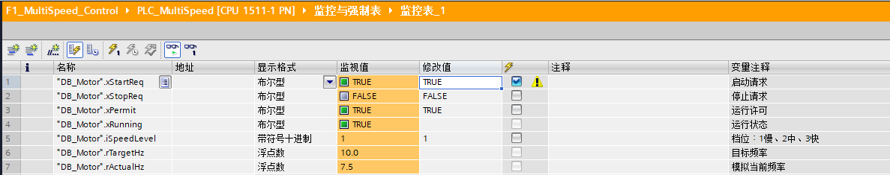

*释放后重新给启动，运行恢复，当前频率上升到7.5 Hz*

我先释放启动请求，再重新给 TRUE，系统才恢复运行。这个“释放后重新启动”的行为，是本次最重要的改进。

|完成内容|实际验证|
|---|---|
|三档选择|慢10、中25、快50 Hz，监控目标值变化|
|启动自保持|启动释放后运行保持|
|模拟加减速|换档时当前频率逐步接近目标|
|停止优先|停止请求使运行取消，目标归零，频率逐渐降到0|
|许可联锁|无许可时不能运行，许可丢失时停机|
|防误重启|启动保持TRUE、许可恢复后仍停机，释放再启动才运行|

> 本次是**变频器多段速控制思路的软件模拟**。rActualHz是程序计算的值，不是真实变频器反馈；没有接实际驱动、电机、端子或模拟量输出，也没有制作HMI。

## 工程与程序总览

|项目|本次配置|
|---|---|
|工程|F1_MultiSpeed_Control|
|PLC|PLC_MultiSpeed / CPU 1511-1 PN|
|虚拟PLC地址|192.168.60.10|
|软件|TIA Portal V19、PLCSIM Advanced V6.0|
|数据块|DB_Motor [DB1]|
|控制程序|OB_MotorControl [OB30]，按100 ms循环设计|
|操作方式|监控表修改一次，未使用强制|
|验证范围|PLC逻辑与软件频率模拟|

我把控制逻辑集中在循环中断OB中，Main暂时留空。循环中断由系统周期调度，不需要再从Main调用。工程树已有OB30；重复搭建时，需要在OB属性中核对周期确实为 **100 ms（100000 μs）**。

许可与停止检查→启动准备→运行自保持→选择目标频率→升降频并限幅

## 变量表：完整12项

所有变量都属于 **DB_Motor**。完整写法例如：`"DB_Motor".xStartReq`。下文为便于阅读省略数据块前缀。

|变量|类型|起始值|含义|
|---|---|---|---|
|`xStartReq`|Bool|false|启动请求，操作时TRUE后释放FALSE|
|`xStopReq`|Bool|false|停止请求；TRUE表示要求停止|
|`xPermit`|Bool|true|运行许可；丢失时取消运行|
|`xRunning`|Bool|false|运行命令状态，不是电机静止反馈|
|`iSpeedLevel`|Int|1|档位：1慢、2中、3快|
|`rTargetHz`|Real|0.0|本轮计算得到的目标频率，Hz|
|`rActualHz`|Real|0.0|软件计算的模拟当前频率，Hz|
|`rLowHz`|Real|10.0|慢档设定频率，Hz|
|`rMidHz`|Real|25.0|中档设定频率，Hz|
|`rHighHz`|Real|50.0|快档设定频率，Hz|
|`rStepHz`|Real|0.5|每轮升降频的变化量，Hz|
|`xStartArmed`|Bool|false|启动准备；许可正常且启动已释放后建立|

展开原始DB截图（基础11项）

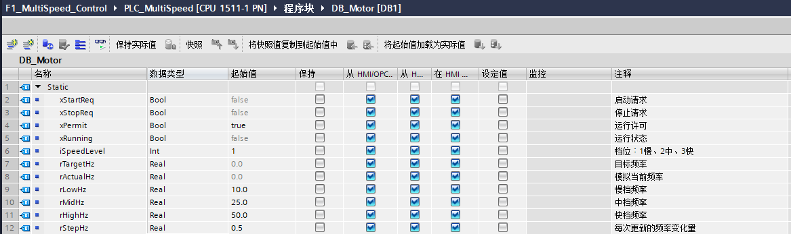

*DB_Motor基础变量表：三档10、25、50 Hz，步长0.5 Hz*

这张是初始变量表，后续新增的xStartArmed以完整12项表为准。

起始值用于初始化，运行中要看“监视值”；只在“修改值”栏填数，还要执行修改。Bool是TRUE/FALSE，Int是整数，Real可以保存小数。Hz表示频率，不直接等于电机转速。

## LAD教程：最终八段程序

最终版本在原七段前加入“启动准备”，共八段，顺序不能随意打乱。下面的接线说明是最终逻辑整理；原先错误的启动准备接线不作为示范图。

### 程序段1 / 启动准备

**串联：** xPermit常开 → xStopReq常闭 → 并联分支 → xStartArmed普通线圈。

并联分支只包含两个触点：

- 上支路：**xStartReq常闭**，表示启动请求已经释放。
- 下支路：**xStartArmed常开**，用于保持已经建立的准备状态。

<b>许可正常 ＋ 没有停止请求 ＋〔启动已释放 或 已准备〕</b> ↓ <b>允许接受下一次启动</b>

许可丢失或停止出现时，xStartArmed会清除。恢复许可时，如果启动仍被按住，准备状态不能重新建立。**这一段只写xStartArmed，不写xStopReq。**

### 程序段2 / 停止优先与运行自保持

先串联 xPermit常开、xStopReq常闭，然后建立两条并联支路，汇合后接 xRunning普通线圈。

|支路|触点连接|
|---|---|
|上支路：发起启动|xStartReq常开 串联 xStartArmed常开|
|下支路：自保持|xRunning常开|

运行后启动可以释放；停止或许可丢失会切断两条支路前的公共条件。自保持支路不能绕过许可和停止触点。

### 程序段3 / 默认目标归零

无条件执行 **MOVE：0.0 → rTargetHz**。

这不是每次把模拟当前频率清零，而是给本轮目标设默认值。随后只有运行且档位有效时，才用对应频率覆盖目标。停机或档位无效时，目标保持0。

### 程序段4～6 / 慢、中、快三档

|程序段|串联条件|MOVE|
|---|---|---|
|4|xRunning常开，iSpeedLevel == 1（Int）|rLowHz → rTargetHz|
|5|xRunning常开，iSpeedLevel == 2（Int）|rMidHz → rTargetHz|
|6|xRunning常开，iSpeedLevel == 3（Int）|rHighHz → rTargetHz|

展开三档LAD接线截图（新增启动准备前的段号）

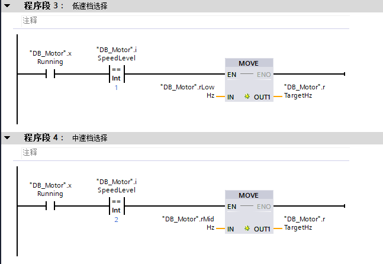

*低档和中档：按档位把对应频率送入目标值*

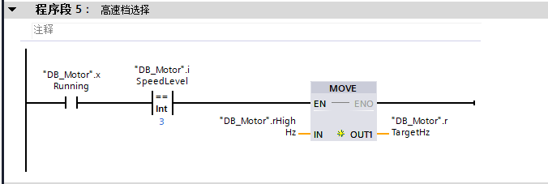

*高档选择逻辑*

### 程序段7 / 模拟升频

条件使用Real比较：**rActualHz < rTargetHz**。条件后串接ADD和MIN，前框ENO连接后框EN。

|指令（Real）|IN1|IN2|OUT|
|---|---|---|---|
|ADD|rActualHz|rStepHz|rActualHz|
|MIN|rActualHz|rTargetHz|rActualHz|

先增加一个步长，再取较小值，避免超过目标。例如目标10.2、当前10.0，增加0.5得到10.5，再由MIN限制为10.2。这个小数例子是逻辑解释，不是额外实测记录。

### 程序段8 / 模拟降频

条件使用Real比较：**rActualHz > rTargetHz**。条件后串接SUB和MAX。

|指令（Real）|IN1|IN2|OUT|
|---|---|---|---|
|SUB|rActualHz|rStepHz|rActualHz|
|MAX|rActualHz|rTargetHz|rActualHz|

先减一个步长，再取较大值，避免降过目标。MIN/MAX都必须在对应条件线路内执行，不能独立无条件运行。

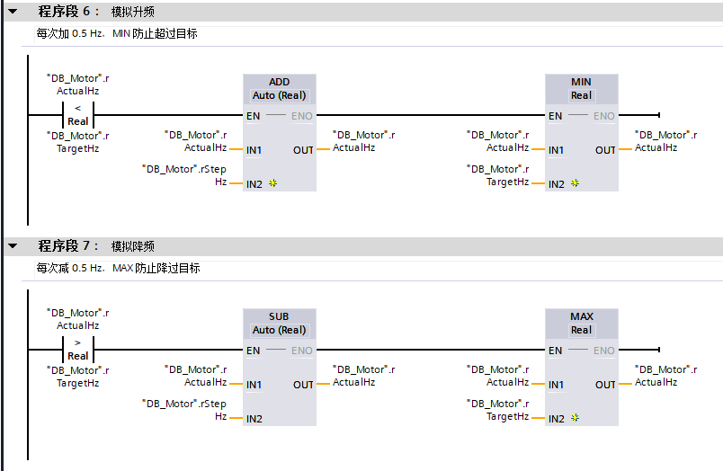

*ADD加MIN模拟升频，SUB加MAX模拟降频*

原图为加入启动准备前的程序段6、7；最终顺延为7、8，运算接线没有改变。

## 为什么会逐渐升降频

每次周期调用改变 **0.5 Hz**，如果OB周期为 **100 ms = 0.1 s**：

**频率变化速率 = 0.5 ÷ 0.1 = 5 Hz/s。**

|变化|按设定周期计算的理论时间|
|---|---|
|0 → 10 Hz|约2秒|
|10 → 25 Hz|约3秒|
|25 → 50 Hz|约5秒|
|50 → 10 Hz|约8秒|

这些时间是按周期和步长计算的理论值，本次没有用计时记录核定实际耗时。模拟加减速只是对变量做步进运算，不能据此宣称已完成变频器斜坡参数设置。

## 我的实测：自保持、升档与降档

*启动请求已释放，运行仍保持TRUE*

启动请求释放为FALSE后，运行仍为TRUE，目标和当前频率保持10 Hz。

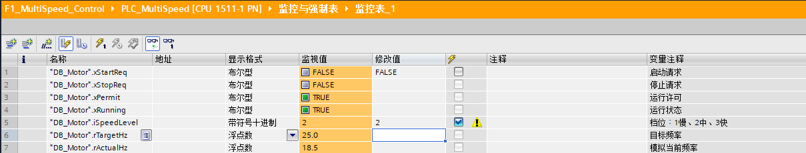

*中档目标25 Hz，模拟当前频率18.5 Hz*

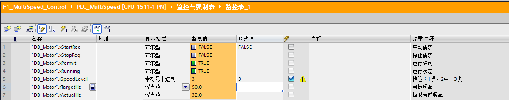

*高档目标50 Hz，模拟当前频率32 Hz*

目标改为25和50 Hz时，当前频率分别经过18.5和32 Hz，说明当前值没有直接跳成目标值。这两张保留的是升频过程，不是25、50 Hz稳态截图。

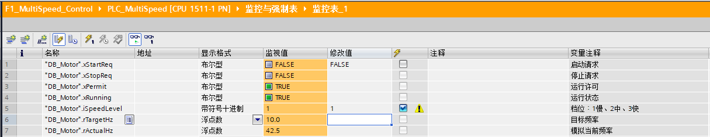

*切回慢档，目标10 Hz，当前42.5 Hz正在下降*

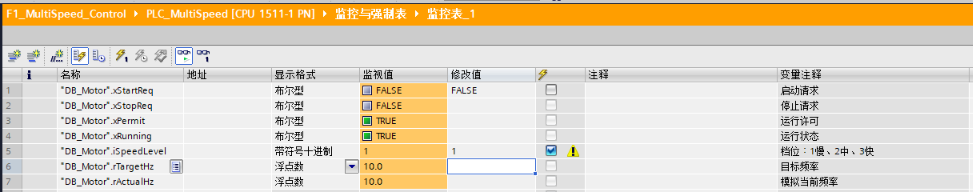

*降回10 Hz后稳定*

切回慢档后，目标10 Hz，当前从42.5 Hz下降，最终稳定在10 Hz。

## 停止时，运行取消与频率归零并非同一时刻

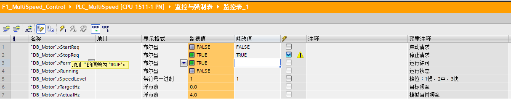

*停止请求TRUE，运行取消、目标0，当前4 Hz尚在降频*

停止请求为TRUE后，xRunning立即在控制周期中取消，rTargetHz变0；但rActualHz还有4 Hz，仍在按步长下降。

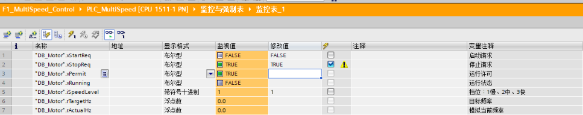

*停止后目标与模拟频率均为0*

最终模拟频率降到0。**xRunning表示运行命令状态，不能把它直接当作电机已静止反馈。** 停止测试结束后应释放停止请求。

## 从“许可联锁”补到“防误重启”

早期版本只有许可、停止与自保持。如果启动请求一直TRUE，恢复许可就会重新启动。因此我加了xStartArmed，要求在许可正常、没有停止请求的条件下先确认启动已释放。

展开完整验证过程

*正常启动，运行TRUE，频率接近慢档目标*

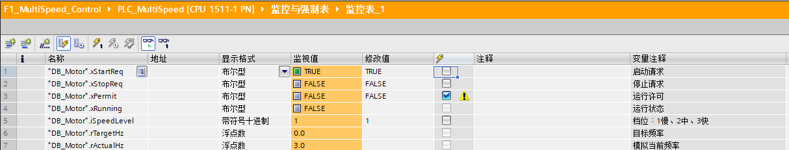

*启动请求保持TRUE，许可丢失，运行取消，当前频率下降*

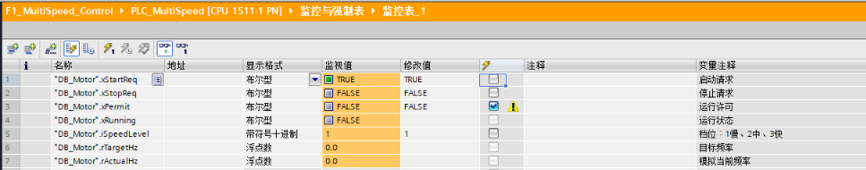

*许可丢失后降频至0，启动请求仍为TRUE*

*许可恢复、启动仍为TRUE，运行保持FALSE，频率保持0*

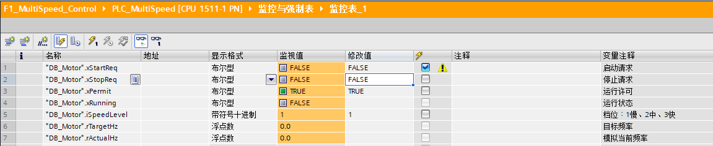

*许可恢复后释放启动，仍保持停机*

*释放后重新给启动，运行恢复，当前频率上升到7.5 Hz*

|测试顺序|操作|已观察到的结果|
|---|---|---|
|1|许可TRUE、停止FALSE，正常启动|运行TRUE，频率上升|
|2|启动保持TRUE，许可改FALSE|运行FALSE，目标0，当前频率下降|
|3|等待降频结束|当前频率0，启动仍TRUE|
|4|恢复许可TRUE，启动不释放|运行仍FALSE、频率0，不自动重启|
|5|启动释放FALSE|仍停机，允许准备接受新启动|
|6|重新给启动TRUE|运行TRUE，频率上升|

这次记录的是**许可恢复场景**下的程序防误重启。不是安全认证功能，也不等于已验证所有断电、重启或故障恢复场景。停止后保持启动请求的类似场景可继续按相同原则检查，未作为本次新增实测结果。

## 我遇到的接线问题

首次补启动准备时，错误地增加了xStopReq输出线圈，导致程序也在改写停止请求；同时缺少启动释放判断。修正后，停止请求仅作为外部操作变量，准备段只写xStartArmed。

我最终用一套操作区验证逻辑：启动、停止、许可、档位，以及运行状态、目标频率、模拟当前频率。监控表还可以加入xStartArmed辅助排障，但**不要手动修改它来绕过准备逻辑**。

## 重新搭建与验收清单

1. 新建F1_MultiSpeed_Control，添加CPU 1511-1 PN，PLC命名PLC_MultiSpeed，地址192.168.60.10。
2. 建立DB_Motor完整12项变量，档位起始值为1。
3. 新建循环中断OB_MotorControl，确认周期100 ms，按最终八段顺序编写LAD。
4. 编译后下载硬件与软件，让虚拟PLC进入RUN；避免同时运行另一台同IP实例。
5. 用“修改一次”测试慢、中、快与降档；启动TRUE后写回FALSE，观察自保持。
6. 发停止请求，确认目标0、模拟频率逐渐降到0，再释放停止请求。
7. 测试启动一直TRUE时丢失许可、恢复许可，确认不自动重启；释放启动后重新启动。
8. 收尾时启动写FALSE，再发停止，频率归零后释放停止请求，让系统保持停机。

基础程序编译记录为0错误、2项CPU保护相关警告；本次成果不延伸为硬件保护配置已完成。

这次项目到此收尾：我完成了**三档频率逻辑与模拟斜坡，并通过许可恢复测试验证了防误重启**。HMI按本次范围跳过，真实变频器、输出端子与电机实测留待以后有设备时进行。
